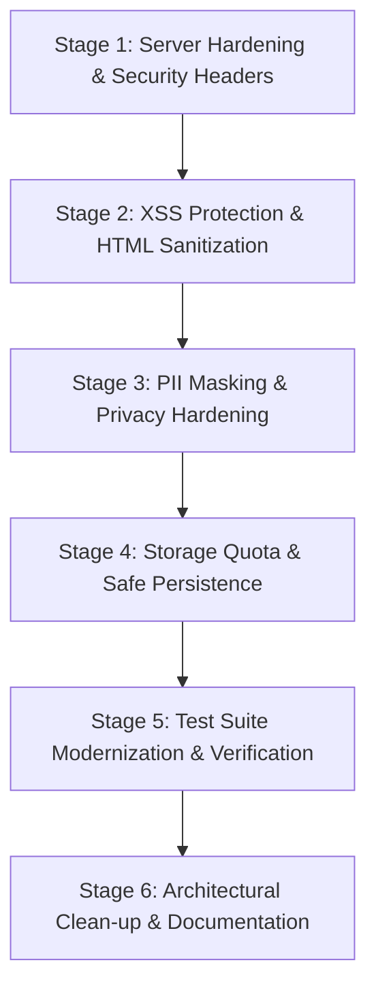

# PROJECT AUDIT: Dantewada Youth Development & Employment Portal
**Auditor**: Senior Software Architect & Code Quality Auditor  
**Date**: October 28, 2026  
**Version**: 2.0.0 / Production Readiness Audit  
**Status**: AUDIT COMPLETE — REMEDIATION IN PROGRESS

---

## 1. Executive Summary

The **Dantewada Youth Development, Employment & Success Story Portal** is a web-based monitoring and citizen engagement platform developed for the **District Administration & Zilla Panchayat, Dantewada (Chhattisgarh)**. It tracks youth employment, skill development, educational linkage, entrepreneurial innovation, field visits with photographic evidence, and public success stories across four administrative blocks: Dantewada, Geedam, Katekalyan, and Kuakonda.

While the application provides extensive domain coverage, bilingual presentation (Hindi/English), and rich administrative views, an in-depth code quality, architecture, and security audit revealed several critical vulnerabilities, architectural anti-patterns, and technical debt accumulated during rapid vibe-coding iterations.

---

## 2. Technology Stack & Current Architecture

| Layer | Technologies & Libraries | Current Implementation |
| :--- | :--- | :--- |
| **Runtime & Server** | Node.js (v18+), native `http`, `fs`, `path` | Lightweight custom static file server (`server.js`) on port 3000 |
| **Frontend UI** | HTML5, CSS3, Tailwind CSS (CDN), FontAwesome 6 | Responsive, two-portal design: Public Portal (`index.html`) & Admin Console (`admin.html`) |
| **Data Visualizations** | Chart.js 4.4.1 (UMD) | Interactive charts for block distributions, social categories, and trends |
| **Spreadsheet Engine** | SheetJS (`xlsx.full.min.js`) | Client-side Excel `.xlsx` and CSV parsing, validation, and multi-sheet export |
| **Data Layer** | In-Memory Object + Browser `localStorage` | Unified Database Service (`js/db.js`) with key `DANTEWADA_PORTAL_DB_V3` |
| **Auth / RBAC** | Client-Side Simulated RBAC (`js/auth.js`) | 7 Government roles with block-level scoping and audit logging |
| **Testing** | Node.js native test runner (`node:test`, `node:assert`) | Unit and schema integrity tests under `test/` directory |

---

## 3. Module & Dependency Overview

### Active Runtime Modules
1. **`server.js`**: Native HTTP server with MIME type dispatching and index routing.
2. **`index.html`**: Public-facing portal with citizen metrics, startup showcase, field visit logs, and grievance intake.
3. **`admin.html`**: District executive console featuring 15 data streams, bulk Excel importer, and digital dossier modals.
4. **`js/db.js`**: Central data store implementing CRUD, KPI aggregations, audit logs, and data ingestion logic.
5. **`js/auth.js`**: Role-based access control service managing user profiles and block permissions.
6. **`js/public-app.js`**: Public portal controller for dynamic charts, startup cards, modals, and bilingual toggling.
7. **`js/admin-app.js`**: Administrative controller (~3,800 lines) managing sheet table views, bulk uploads, and dossiers.
8. **`js/seed-data.js`**: Offline dictionary and baseline dataset (~914 KB).

### Inactive / Legacy Modules (Dead Code)
- `js/api.js`, `js/app.js`, `js/dashboard.js`, `js/dataset.js`, `js/env.js`, `js/forms.js`, `js/gallery.js`, `js/pmegp_data.js`, `js/portal.js`, `js/rangde_data.js`, `js/reports.js` (~600 KB total).
- These files are leftovers from earlier monolithic single-page prototypes before the application was split into `index.html` and `admin.html`. They are not imported or loaded by any active page.

---

## 4. Critical Risks & Bugs Discovered

### A. Security Vulnerabilities
1. **Path Traversal & Sensitive File Leakage in `server.js` (CRITICAL)**:
   - `server.js` uses `path.normalize(reqUrl).replace(/^(\.\.[\/\\])+/, '')` which only strips leading `..`. It does not prevent middle-path traversal (e.g. `/js/../../.env`).
   - `server.js` serves ANY file residing within the project directory. Any user can download `.env`, `package.json`, `server.js`, or repository internals by requesting `http://localhost:3000/.env`.
   - Missing security headers (`X-Content-Type-Options: nosniff`, `X-Frame-Options: SAMEORIGIN`, `Referrer-Policy`, restrictive `Content-Security-Policy`).
   - Unrestricted CORS wildcard (`Access-Control-Allow-Origin: *`) across all files.

2. **Stored Cross-Site Scripting (XSS) (CRITICAL)**:
   - Dynamic user-supplied data imported via Excel/CSV or entered in forms (founder names, startup pitches, training trades, remarks) is interpolated directly into `element.innerHTML` across `admin-app.js` and `public-app.js` without HTML escaping.
   - An uploaded spreadsheet containing payload strings (e.g. ``) executes arbitrary scripts in the administrator's or visitor's browser context.

3. **Public PII Exposure (HIGH)**:
   - In `openPublicStartupDetail(id)` inside `js/public-app.js` (line 763), entrepreneur contact numbers (`idea.mobile`) are displayed in raw unmasked format to the public, violating district PII privacy guidelines.

### B. Functional & Data Integrity Bugs
1. **Silent Data Loss on Quota Exceeded (HIGH)**:
   - `DatabaseService.persist()` catches `localStorage.setItem` errors silently without informing the caller. If a user uploads a large Excel file that exceeds the ~5MB browser storage quota, the UI falsely reports success, but data is discarded upon page reload.
2. **Unhandled Stream Error in `server.js` (MEDIUM)**:
   - `fs.createReadStream().pipe(res)` lacks an error handler. If a network socket abruptly terminates during streaming, an unhandled `error` event can crash the Node process.
3. **Outdated Tests in Test Runner (MEDIUM)**:
   - `test/entrepreneur_tabs.test.js` was written for an obsolete legacy layout of `index.html`, causing `node --test test/*.test.js` to fail.

---

## 5. Code Quality & Architectural Concerns

1. **Monolithic Controller Anti-pattern**:
   - `js/admin-app.js` spans over 3,800 lines with high cyclomatic complexity, deeply nested string concatenations for HTML modals, and duplicated table row renderers.
2. **Missing Central Utility for Safe Encoding**:
   - No standardized `escapeHtml()` function is accessible to `admin-app.js` and `public-app.js`.
3. **Unbounded DOM Table Rendering**:
   - Rendering thousands of records without pagination or virtual scrolling causes unnecessary UI lag on mobile and lower-end government office hardware.
4. **Frequent Full-State JSON Serialization**:
   - The entire database state is re-serialized on every single audit log or row edit, causing CPU spikes.

---

## 6. Prioritized Remediation Plan

| Phase | Task | Target Files | Risk Level |
| :--- | :--- | :--- | :--- |
| **Phase 3** | Hardened `server.js`: restrict access to private files (`.env`, `.git`, etc.), fix traversal, add security headers, handle stream errors | `server.js` | Critical / Low risk |
| **Phase 3** | Introduce shared `escapeHtml()` and sanitize dynamic template injections | `js/admin-app.js`, `js/public-app.js`, `js/db.js` | Critical / Low risk |
| **Phase 3** | Mask entrepreneur mobile numbers on public startup detail views | `js/public-app.js` | High / Low risk |
| **Phase 4 & 6** | Improve `persist()` with quota detection and user warning | `js/db.js`, `js/admin-app.js` | High / Low risk |
| **Phase 7** | Modernize legacy test suite and add security regression tests | `test/entrepreneur_tabs.test.js`, `test/portal.test.js` | Medium / Zero risk |
| **Phase 8 & 9** | Remove/archive dead code, verify all checks, update documentation | Repo root, `README.md` | Low / Zero risk |
